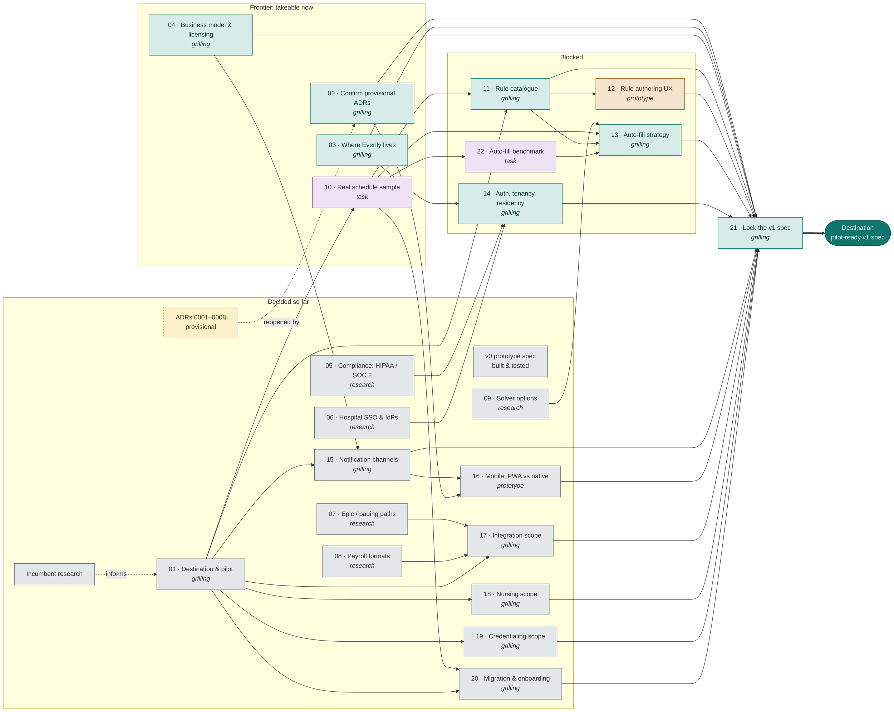
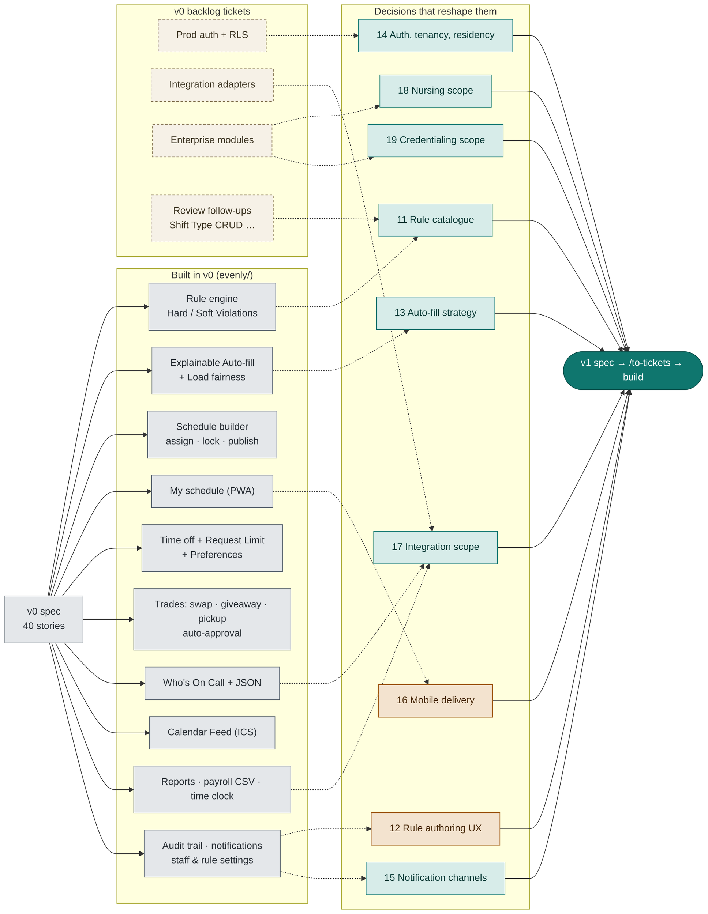

# Evenly v1 — flowcharts

Generated by `render_map.py` from [map.md](./map.md) and `issues/`. Do not edit by hand.

## Decision map (wayfinder)

Solid arrows are **Blocked by** edges. Colour = ticket type: teal grilling (HITL), blue research (AFK), amber prototype (HITL), violet task, grey resolved.

## Features & specs → decisions

